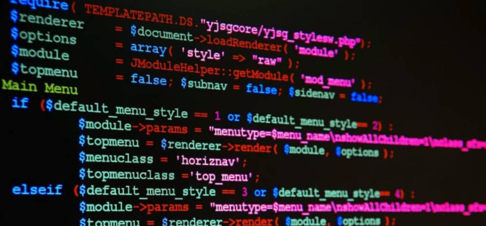

# MI PRIMER .MD

## 1. ¿Qué es un programa informático?
Un programa informático es una serie de instrucciones escritas en un lenguaje de programación, de tal manera que un ordenador o máquina pueda interpretarlo y realizar acciones o resolver problemas.

## 2. Diferencia entre código fuente, código objeto y código ejecutable.
Explicandolo con mis palabras, el código fuente sería basicamente lo que nosotros escribimos aplicando la lógica y el lenguaje de programación que necesitemos, el codigo objeto seria lo que el compilador interpreta de nuestro codigo fuente, y el código ejecutable sería ya el código organizado en librerias y con todas las instrucciones completas para que una cpu los interprete y ejecute el programa.

## 3. Etapas del desarrollo del software
- Analizar que necesitamos y cual sera la finalidad.
- Decidir como vamos a llevar a cabo el proyecto y que herramientas se usaran.
- Picar el codigo en base a la necesidad de las decisiones anteriores.
- Hacer test y buscar posibles fallos y brechas del codigo.
- Se implementa el programa o aplicación en dispositivos finales.
- Mantenimiento de posibles fallos reportados y también añadir nuevas funciones o actualizaciones que se requieran.

## Ejemplo de un lenguaje de programación

[Enlace a mi repositorio en GitHub](https://github.com/borjaDAM25/1DAMV_CanellaVazquez_Borja)
